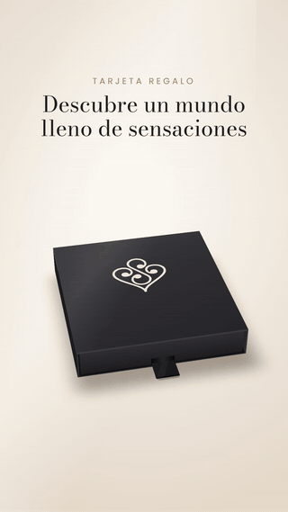
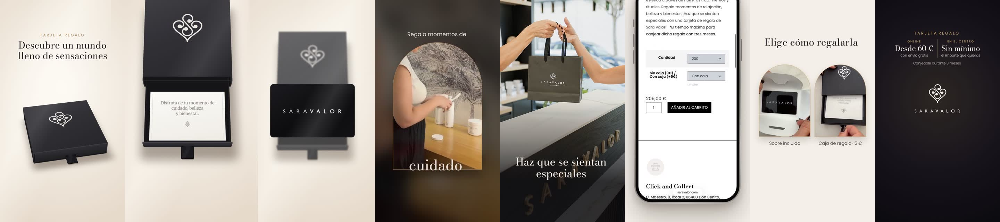

# Tarjeta regalo Sara Valor · Vídeo para Instagram Stories/Reels

Pieza publicitaria vertical (1080 × 1920, 29,6 s) programada íntegramente con **[Remotion](https://www.remotion.dev/)**, React y TypeScript para la campaña de tarjetas regalo de un centro de estética.

Cada escena, transición, movimiento de cámara y animación de texto está escrita en código. El vídeo se renderiza a partir de los recursos del cliente, de forma reproducible y editable.

<p align="center">
  
</p>

<p align="center">
  <a href="media/sara-valor-tarjeta-regalo.mp4"><strong>▶ Ver el vídeo completo (MP4, 1080 × 1920)</strong></a>
</p>



> El vídeo de demostración se publica sin música: la pista usada en la campaña no forma parte de este repositorio.

---

## El encargo

Un centro de estética necesitaba un vídeo para Instagram Stories/Reels que diera a conocer su tarjeta regalo de cara a la campaña de Navidad y llevara a su compra online.

**Requisitos:**
- Formato 9:16 para Stories/Reels, respetando las zonas que tapa la interfaz de Instagram y dejando hueco libre para el sticker de enlace.
- Tono cálido, sereno y premium, coherente con la identidad de la marca.
- Mostrar el producto real (caja, tarjeta impresa y tarjeta regalo), el centro, la compra en la web y las opciones de presentación.
- Mensajes comerciales claros: precio online, compra en el centro y caducidad.

## Estructura del vídeo

| # | Escena | Qué ocurre |
|---|---|---|
| 1 | **Apertura** | Caja de regalo en un estudio luminoso. El cajón se abre, aparece la tarjeta impresa con su frase, se retira y la tarjeta regalo sube hacia la cámara. |
| 2 | **Transición de rendija** | La tarjeta gira hasta quedar de canto y esa línea se abre como una rendija hacia la escena siguiente. |
| 3 | **El centro** | "Regala momentos de *cuidado, belleza, bienestar*": vídeo real enmarcado en arcos, el motivo arquitectónico del centro. |
| 4 | **Entrega** | "Haz que se sientan especiales". |
| 5 | **Compra online** | La web real dentro de un mockup de iPhone, con acercamiento al botón de compra. |
| 6 | **Opciones** | Sobre incluido o caja de regalo, con las grabaciones reales de ambos. |
| 7 | **Cierre** | Precios online y en el centro, caducidad y logotipo, con espacio para el enlace. |

## Aspectos técnicos destacados

### Apertura 3D construida solo con CSS
La caja, el cajón, la tarjeta impresa y la tarjeta regalo son elementos HTML colocados en un espacio 3D con `transform-style: preserve-3d` (`src/scenes/intro/`). Una cámara virtual controla inclinación, giro, escala y punto de interés en cada fotograma.

Detalles de acabado:
- **Funda abierta por delante**, como la caja real: el cajón sale por su boca.
- **Tirador de cinta de raso**, con trama, costuras y doblez.
- **Reflejos** que se desplazan sin mostrar cortes en los bordes.
- **Profundidad de campo:** la caja se desenfoca cuando la tarjeta sube hacia la cámara.
- **Doble capa:** la tarjeta se dibuja en su propia capa para cruzar por delante de la caja sin errores de orden en 3D.

La tarjeta regalo usa las proporciones reales del formato ISO de tarjeta (85,6 × 54 mm, radio de 3,18 mm).

### Por qué una apertura 3D y no la grabación real
Las grabaciones disponibles de la caja medían 462 px de ancho, menos de la mitad del formato final. Se probaron dos enfoques sobre el vídeo real:
- Enderezar la caja con un seguimiento propio fotograma a fotograma, que mide la orientación dominante de sus bordes.
- Integrar la grabación en el fondo con máscaras radiales.

En ambos casos la resolución limitaba el resultado. La versión 3D se dibuja nítida a 1080 × 1920 y respeta el diseño real del producto.

### Marca vectorizada
`scripts/trace-brand.mjs` vectoriza el símbolo y la rotulación a partir de los originales con [potrace](https://github.com/tooolbox/node-potrace): reescalado, desenfoque controlado y relleno `evenodd`. Así el logotipo se mantiene nítido a cualquier tamaño. Los vectores reales no se publican (ver [Recursos privados](#recursos-privados)).

### Transiciones a medida
`src/transitions.tsx` implementa presentaciones propias para `@remotion/transitions`:
- **Rendija:** la tarjeta de canto se abre en vertical con dos filos dorados.
- **Arco:** recorte con la forma de las puertas del centro, que se expande con un filo dorado.
- **Foco:** fundido con desenfoque y ligera escala.

### Mockup de iPhone sin dependencias
`src/components/IPhoneFrame.tsx` dibuja en CSS un iPhone Pro con marco metálico, botones laterales, isla dinámica y reflejo de pantalla. La pantalla muestra la grabación real de la web.

### Pipeline de recursos reproducible
`npm run assets` (`scripts/prepare-assets.mjs`) genera todos los derivados con `sharp` y `ffmpeg-static`, sin tocar nunca los originales:
- Recortes que eliminan marcas de agua y la barra de estado.
- Corrección de color.
- Reencuadres en arco.
- Reescalado con `lanczos` y enfoque suave.

### Detalles de producción
- **Zonas seguras de Instagram:** la composición `GiftCardStoryGuides` las muestra junto con el hueco del sticker de enlace.
- **Ritmo:** todas las duraciones se centralizan en `src/constants.ts`, y la duración total se calcula a partir de ellas.
- **Texto:** aparece palabra a palabra con *easing* suave.
- **Acabado:** grano de película generado por fotograma para unificar fuentes de distinta calidad.
- **Música:** entra baja en la apertura y crece al abrirse la rendija.

## Proceso

El vídeo se desarrolló por iteraciones, revisando fotogramas a resolución completa en cada versión:

| Versión | Cambio principal |
|---|---|
| v1 | Prototipo de 16 s con apertura simulada a partir de fotografías |
| v2 | 30 s, grabación real de la caja, mockup de iPhone y escena de opciones |
| v2.1 | Apertura enderezada por seguimiento y transición de entrada en la tarjeta |
| v2.2 | Apertura rediseñada desde cero en 3D y transición de rendija |
| v2.3 – v2.4 | Acabados: funda abierta, tirador de raso y reflejos sin cortes |
| v2.7 – v2.9 | Mensajes comerciales precisos y cierre centrado en el logotipo |

## Estructura del proyecto

```text
.
├── media/                     Vídeo final, vista previa y storyboard
├── scripts/
│   ├── prepare-assets.mjs     Genera public/derived a partir de los originales
│   └── trace-brand.mjs        Vectoriza el símbolo y la rotulación
└── src/
    ├── Root.tsx               Composiciones
    ├── GiftCardStory.tsx      Secuencia de escenas, transiciones y música
    ├── constants.ts           Formato, zonas seguras, colores y duraciones
    ├── transitions.tsx        Transiciones de rendija, arco y foco
    ├── brand/                 Componentes de marca (vectores privados)
    ├── components/            Mockup de iPhone, texto animado, grano y guías
    └── scenes/
        ├── intro/             Caja, tarjeta impresa y tarjeta regalo en 3D
        └── *.tsx              Centro, entrega, compra, opciones y cierre
```

## Cómo ejecutarlo

Requiere Node.js 20.19 o superior.

```bash
npm install
npm run dev      # Remotion Studio en http://localhost:3000
npm run lint     # ESLint + TypeScript
```

Con los recursos del cliente en `public/assets/`:

```bash
npm run assets   # genera public/derived
node scripts/trace-brand.mjs
npm run render   # out/gift-card-story.mp4
```

## Recursos privados

Este repositorio publica el código y la pieza final. No incluye:
- **Material del cliente:** fotografías y grabaciones originales, archivos de marca y derivados (`public/`).
- **Vectores reales del logotipo:** `src/brand/marks.ts` contiene formas neutras de marcador.
- **Música de la campaña.**

Sin esos recursos, el proyecto compila y se abre en Remotion Studio, pero las escenas que usan fotografías y vídeos aparecen vacías.

## Tecnologías

[Remotion 4](https://www.remotion.dev/) · React 19 · TypeScript · `@remotion/transitions` · `@remotion/media` · `@remotion/google-fonts` · sharp · ffmpeg-static · potrace

---

La marca, el logotipo, el producto y el material audiovisual pertenecen a **Estética Integral Sara Valor** y se muestran con fines de portfolio.
